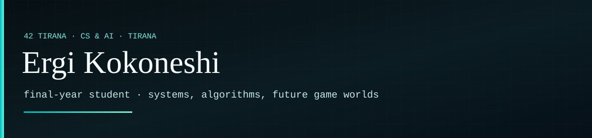

  
   
  
   
  
  
  
  

---

### About

Hey — I’m **Ergi**, based in Tirana. I’m in my final year of **Computer Science & AI** at **Western Balkans University** and a **Common Core** student of the **42 Network** at **42 Tirana** (C Piscine completed).

I care about the part of programming that is usually invisible: clean logic, data structures, systems, and the discipline I picked up at 42. Game development is the long-term target. Until then I’m stacking C, Java (including Spring Boot), Python, Linux, MySQL, networking, and algorithms — then using them on real projects.

- 🔭 Final year CS & AI · Common Core at 42 Tirana
- 🎮 Aiming at game development without skipping the computer-science foundation
- 🤝 Open to collaborate on systems, algorithms, Java/Spring, C, and game-adjacent experiments
- 📫 [ergikokoneshi@gmail.com](mailto:ergikokoneshi@gmail.com) · [LinkedIn](https://www.linkedin.com/in/ergi-kokoneshi-36a939281)

---

### Education & training

| When | What |
| --- | --- |
| 2024.10 → present | **Computer Science & AI** — Western Balkans University, Tirana · EQF 6. Programming, algorithms, databases, OS, ML/NLP, networks, cybersecurity, web, cloud, professional practice. |
| 2026.05 → present | **Common Core** — 42 Tirana. C & Python, algorithms, secure architecture, networks, sysadmin, Docker, peer learning. |
| 2026.06.19–21 | **Junction X Tirana** hackathon. 48-hour prototype with a multidisciplinary team, mentors, and a judged demo. |
| 2024.05.23 | **C2 English** — Cambridge Advanced English |

---

### LeetCode

Live cards from [`bhXAiLt1s5`](https://leetcode.com/u/bhXAiLt1s5/) — problems solved mostly in **Python3**, plus Java and C.

  
    
  

---

### Skills

  

`C` · `Java` · `Spring Boot` · `Python` · `DSA` · `Linux` · `MySQL` · `Networking` · `Virtual machines` · `Web fundamentals` · `Peer review` · `Teamwork`

**Languages:** Albanian (native) · English (C2)

---

### Work

**Advertising copywriter** — Fiverr · 2024.08.16 – 2024.10.01 · Tirana  
Remote slogans and product copy for marketing sites.
